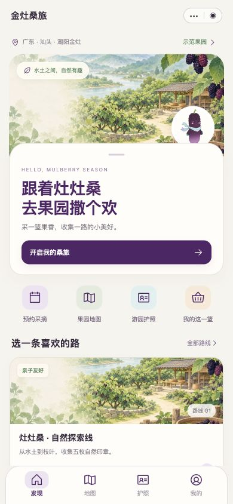

# 金灶桑旅 · 微信小程序

以金灶桑葚农文旅体验为场景的原生微信小程序，配套浏览器交互预览。当前版本 V1.2.0。

## 手机界面



## 原生工程

仓库根目录包含 `app.json` 和 `project.config.json`，可直接导入微信开发者工具。20个独立页面：18个游客页面、工作人员端和内容来源；发现、地图、护照、我的仍为四个底部入口。

配色沿用课程品牌：桑葚紫 `#512567`、浅桑紫 `#A77BB9`、榕江水蓝 `#A8D2D7`、自然绿 `#50835B`、暖米白 `#F7F4ED`。V1.2参考绘本导览、场景图文卡片和轻量农业信息界面，保留原有Logo与二维灶灶桑。

## 运行与上传

1. 在微信开发者工具中导入本仓库根目录。
2. 未注册AppID时按工具提供的测试号或无AppID入口运行；`touristappid`只作本地占位。
3. 有真实小程序AppID后填入导入界面，或运行 `npm run appid -- wx你们的真实AppID`。
4. 编译、手机预览、真机验证后，可在开发者工具上传并在小程序后台设置体验版。

原生工程无需安装npm依赖或启动网页服务器。更多说明见 [导入与部署说明](导入与部署说明.md)。

## 浏览器预览

`preview/` 是同一旅程的移动端浏览器预览，便于快速评审，不是微信源码的替代品。

```sh
python3 -m http.server 4173 --bind 127.0.0.1 --directory preview
```

浏览器打开 `http://127.0.0.1:4173/#home`。宽屏显示评审面板，手机宽度显示单列界面。

## 功能

- 预约与到园核验、两条路线及五个导览节点。
- 二维码识别、问答重试、印章去重与数字游园护照。
- 采摘照片、工作人员确认重量、加工或寄送意向。
- 服务状态流转、纪念卡保存、多段独立旅程。

业务数据暂存本地；工作人员角色为当前设备内的演示。尚未接入多用户云端同步、真实支付、物流或GPS定位。

## 验证

```sh
npm test
```

原生导航及状态自动检查、微信官方WCC/WCSC编译、浏览器完整流程和320/390/430像素移动布局已验证。详见 [验收记录](验收记录.md) 和 [视觉QA](design-qa.md)。

微信开发者工具模拟器与真机API仍需拥有AppID后继续验证。官方编译通过不等于已上传或审核发布。

## 素材

Logo及灶灶桑来自团队课程资料。两张果园插画由内置ImageGen生成，提示词和素材来源见 [素材说明](docs/assets.md)。图标使用Phosphor Icons（MIT），许可保留在 `assets/icons/LICENSE-Phosphor`。

引用图片只作为私有设计参考，不随仓库上传原始参考图或课程PDF。
